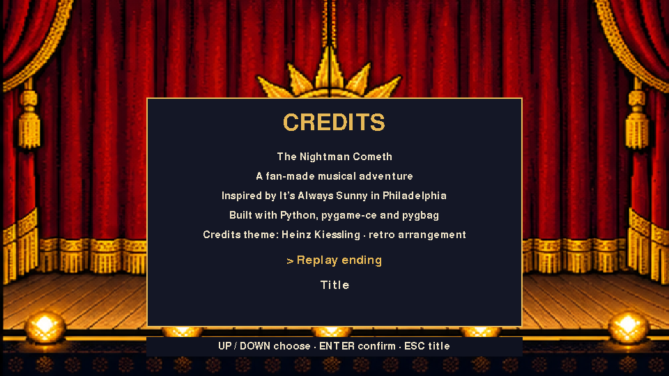

# Credits control hint contrast

Actual renderer at the runtime fingerprint in manifest.json, 960x540 SDL dummy.
Reproduce: initialize pygame, create a fresh Session with empty in-memory storage,
enter_screen("credits"), then Renderer.draw. Main visually inspected credits.png.
No assets, text or audio were changed; the existing controls now have opaque INK backing.

Observed regression: bright stage pixel at(230,487) was(255,240,190), expected INK.
After the fix all14 focused desktop/menu tests passed. Current full browser/package
evidence must be renewed; this local render is not browser or listening acceptance.

