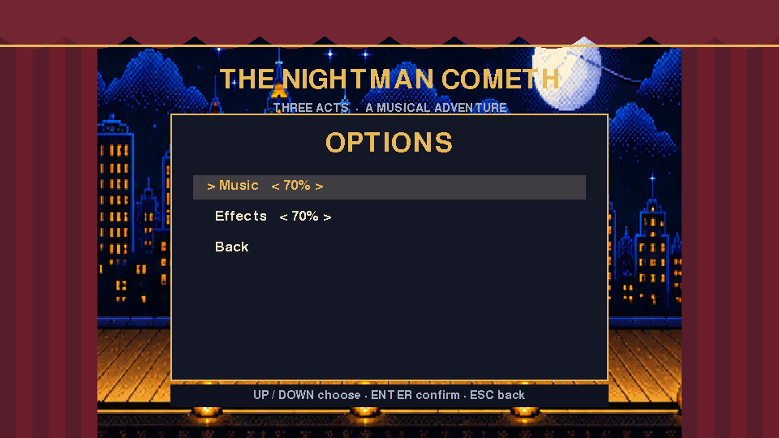

# Menu hint readability correction

Main inspected the independent native options screenshot and observed keyboard hints
crossing bright footlights. Added opaque dark backing under existing hint. No text,
control mapping or menu positions changed. Regression first failed on the bright pixel
(255,240,190) versus expected dark(15,18,32); after correction13 focused menu/desktop
tests pass. An earlier test setup lacked video initialization; that environment error
was corrected and is not counted as the behavioral red.

Actual native source options capture at960x540 from the source tree in this commit:
`SDL_VIDEODRIVER=dummy SDL_AUDIODRIVER=dummy python tools/desktop/launch.py
 --verify-install /tmp/nightman-m9-menu-check`. Visually inspected: legible controls on
dark backing, no private data. Not browser, physical audio, hardware or targetOS proof.

Native package diagnostic now also renders options; workflow deliberately removes and
corrupts proposal audio and requires failure, restores exact bytes, then reruns the
successful diagnostic before archiving. These target-runner outcomes remain pending.
Diagnostic failures exit1 instead of invoking a windowed uncaught-exception dialog.
All previous package screenshots are historical until refreshed on this source.
