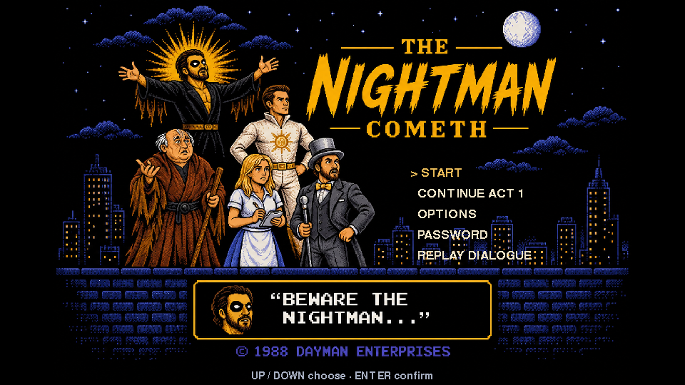

# M9 preparation evidence

Observed red: native Storage wrote JSON but a fresh instance returned None (one failing
persistence test). NativePad executable stub subsequently failed connected/mapping,
unknown-device and disconnect contracts. Storage replacement/controller translation
then passed the focused tests; complete unit suite214 passed before three added platform/
shared release-barrier checks. Follow-up results are recorded on the PR.

Installation diagnostic: `SDL_VIDEODRIVER=dummy SDL_AUDIODRIVER=dummy python
 tools/desktop/launch.py --verify-install /tmp/nightman-desktop-source-check` passed.
Linux aarch64, Python3.11.2, pygame-ce2.5.8;24 approved cues decoded; save survived a
fresh FileStorage instance; actual native title renderer captured at960x540 and visually
inspected. No private data observed. Source-tree capture accompanies this commit;
no renderer/art/music changes. This is not a Mac/Windows package or audible playback.

Browser desktop/narrow captures and packaged-native captures remain pending. Three full
qualifying routes, physical USB, recording inspection and independent E2E remain open.

Follow-up:10 desktop boundary tests passed, including platform save paths and shared
controller disconnect/release behavior. Production asset staging initially failed because
the reused stage helper requires a new directory; fixed by staging into a child directory.
Retest passed with no WAV source audio or QA fixture file in staging.

Independent review found two accepted defects: pygame's actual controller method is
`attached()`, not `get_attached()`; and a failed install-check save could compare None
with None. Regression doubles now use the real Controller API as spec_set. Observed two
failing reconnect/retained-frame assertions before the method correction; both pass after.
Observed a failed assertion expecting the installation check to reject denied writes;
check now requires successful save and equal nonempty restored Session progress. All12
focused desktop tests pass. No previous installation persistence claim substitutes for
rerunning this corrected check on the final target-platform packages.
