# Actual-branch polish evidence

See [manifest](manifest.json) for source/build fingerprints, state metadata and viewport. Captures are Chromium 139 on the Pi. Orange QA labels identify diagnostic fixtures; geometry fixtures only set the floor starting point and remove combatants. Narrow view verifies desktop-only guidance.

### billboard-and-sign

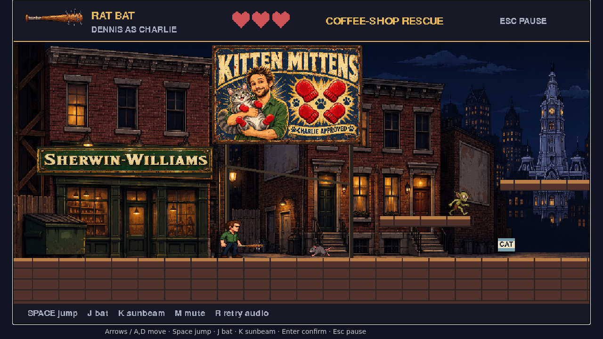

### first-platform-landed

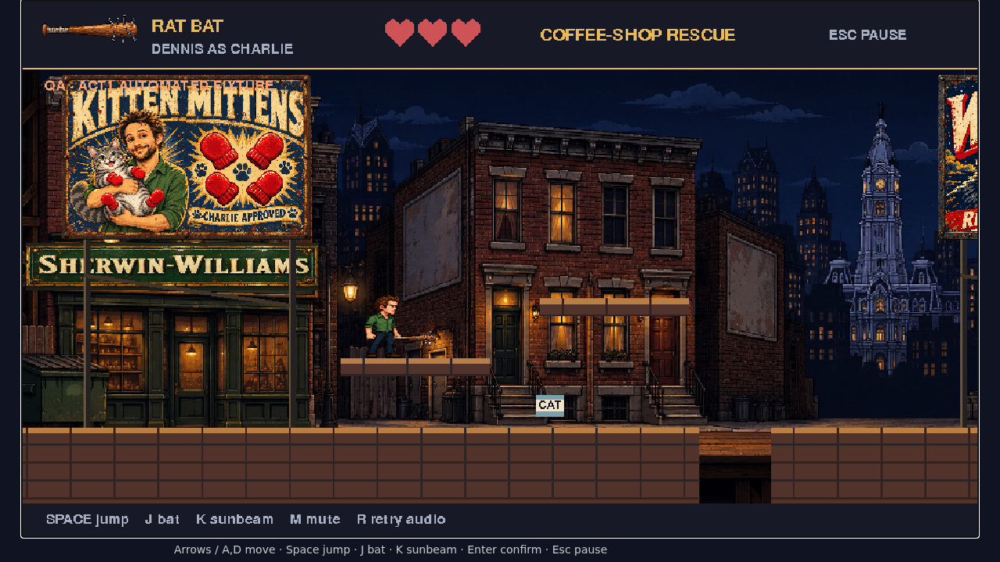

### platform-upper

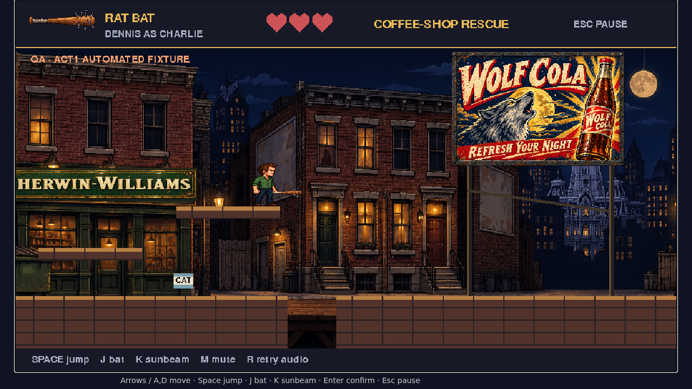

### platform-return

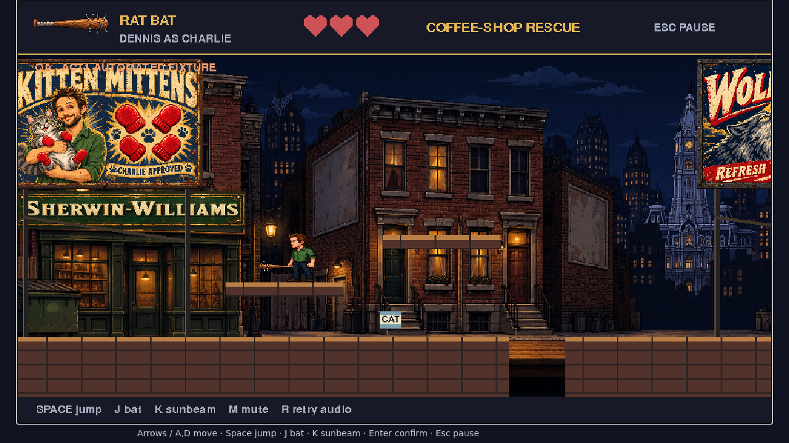

### platform-second-upper

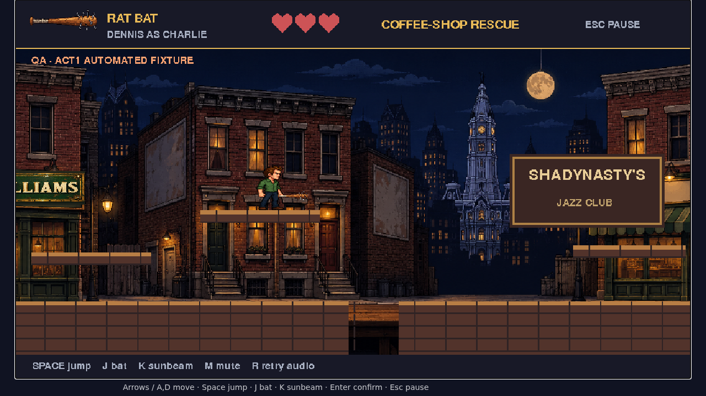

### platform-second-return

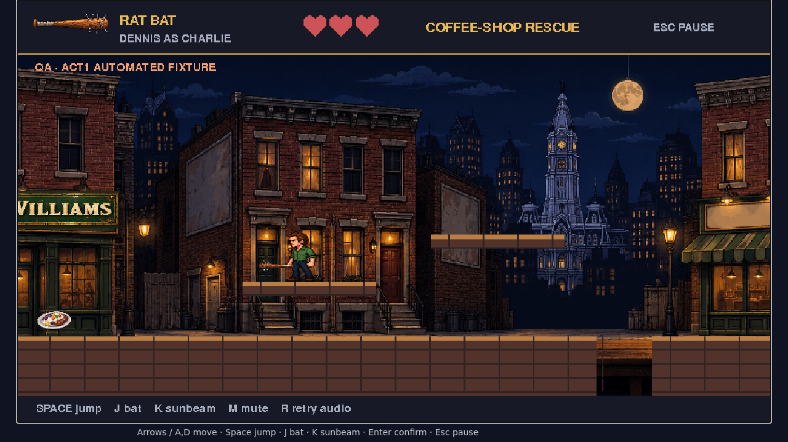

### third-platform-landed

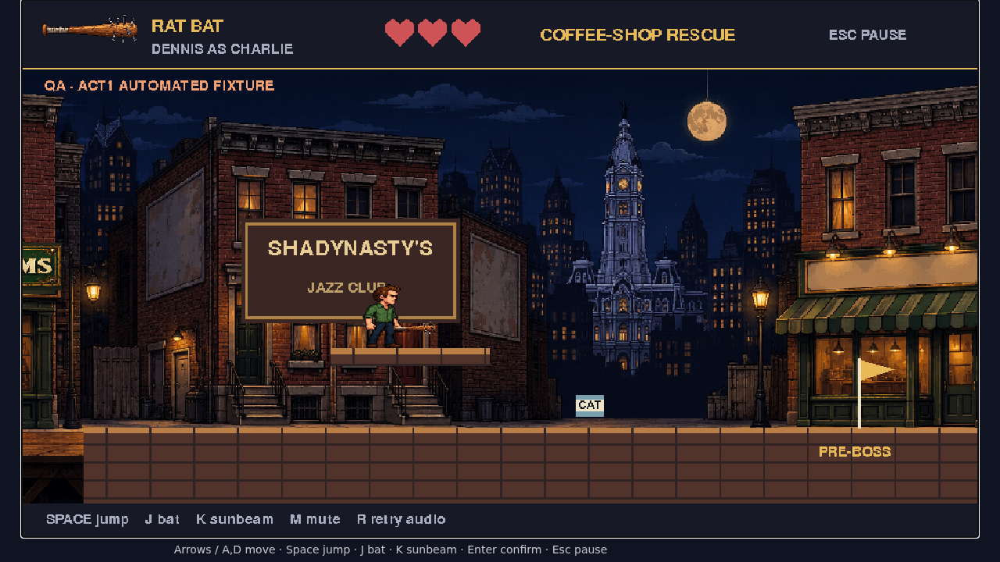

### platforms-1920

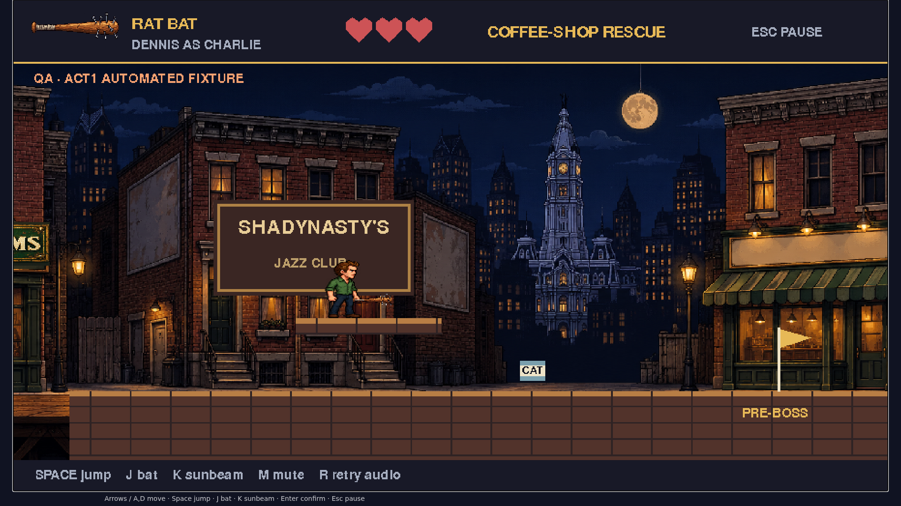

### narrow-guidance

### wolf-billboard

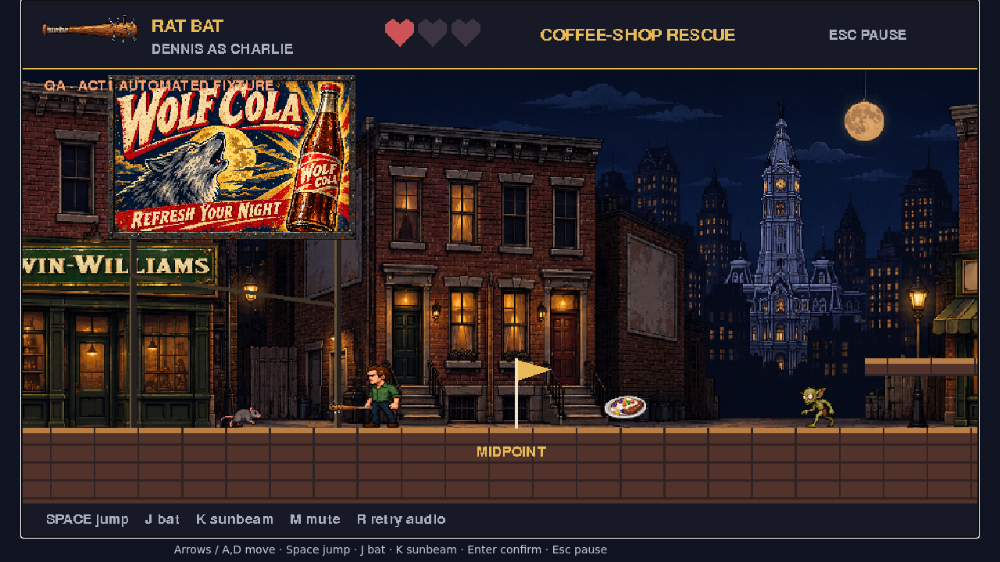

### paused-animation

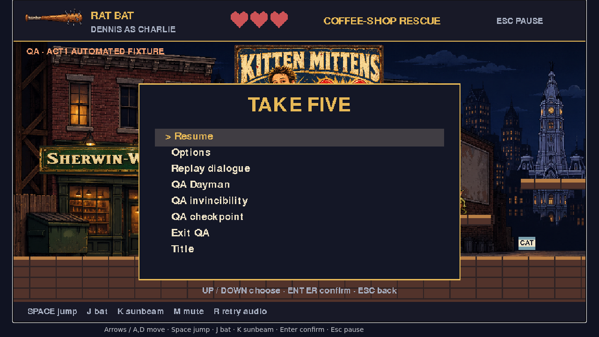

### bat-strike-browser-pose

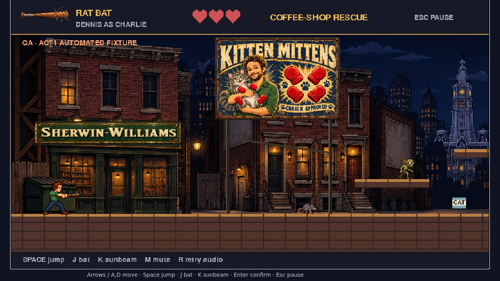

## Supplemental actual-renderer motion poses

These sheets show distinct limb/body poses and mirrored Dennis/Dayman swings. Browser input/pause checks supplement these deterministic native renders.

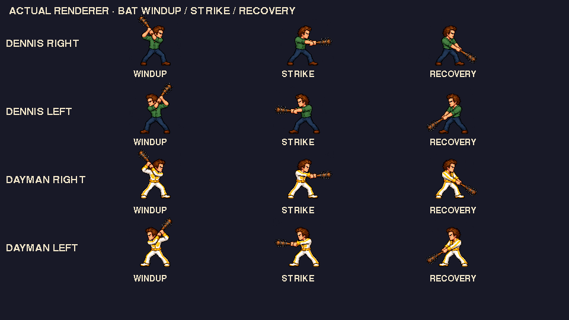

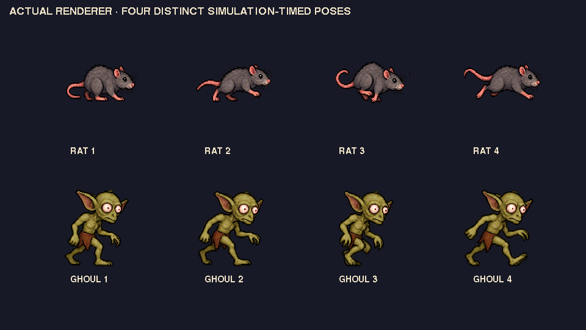
