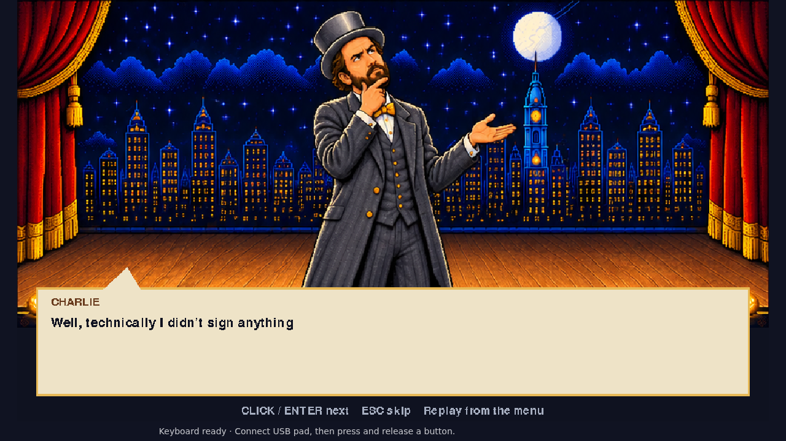
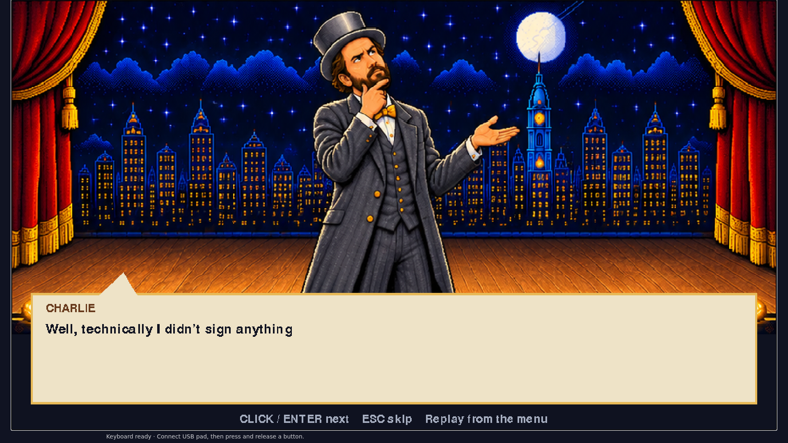
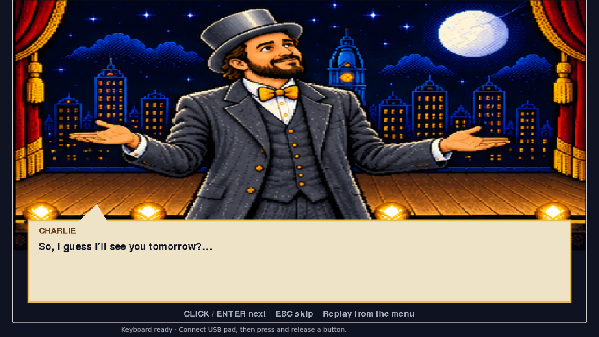
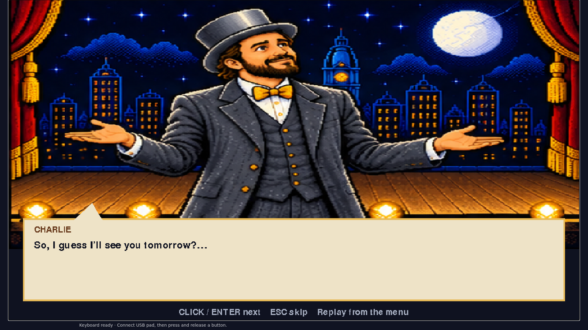
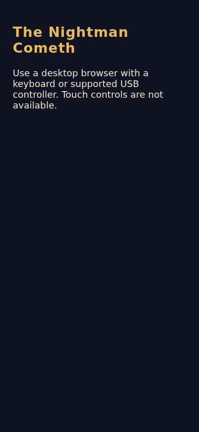
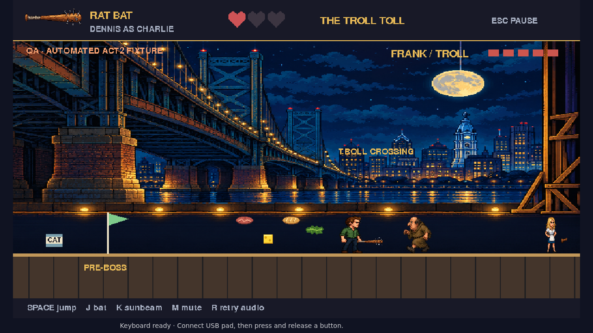
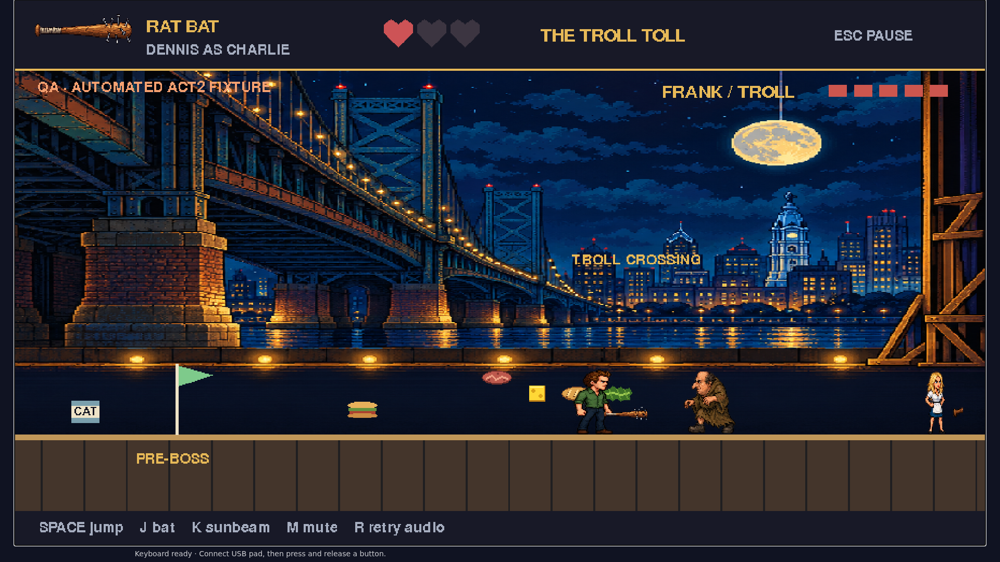

# Sandwich and finale browser evidence

Tested source: `bbe6ca30ffac35467e8e5d78919b48359e64aab6`. Runtime fingerprint: `e8772b9334411d49b72213eab9779f39ac05b9e1aef36fa0494f22a6cda4e0d6`.

Focused actual Chromium workflow passed (1 test,1.4min). Main inspected all9 captures: recognizable ingredients, readable dialogue, narrow unsupported-device messaging; no private content. Fixture captures do not qualify as full playthroughs. Source remains unchanged in this evidence-only commit.

