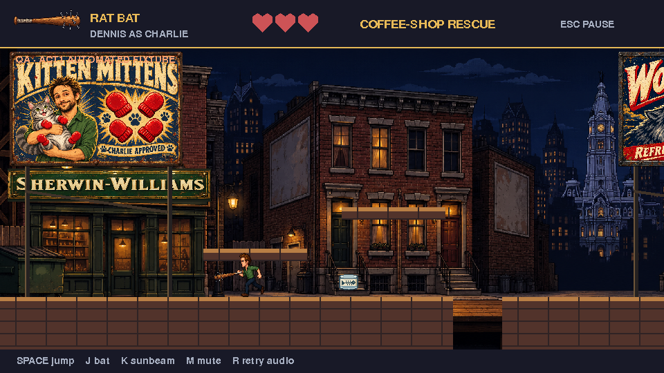
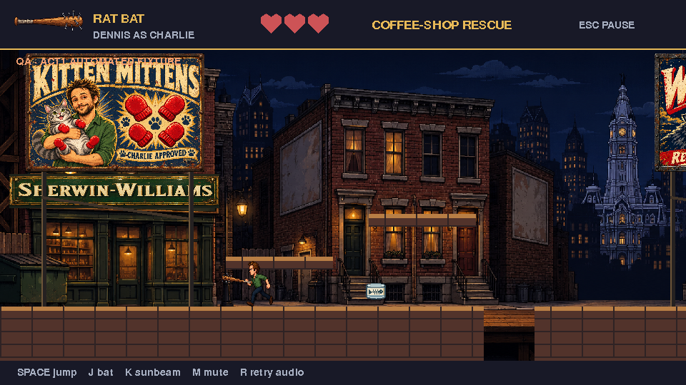
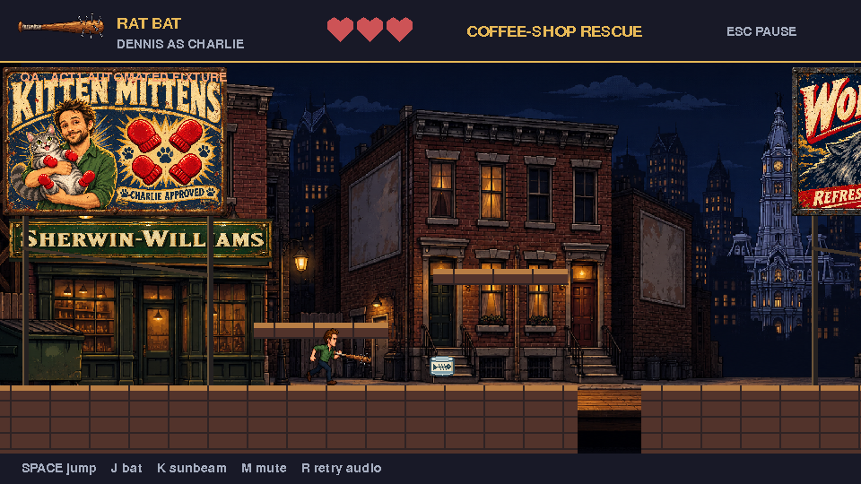
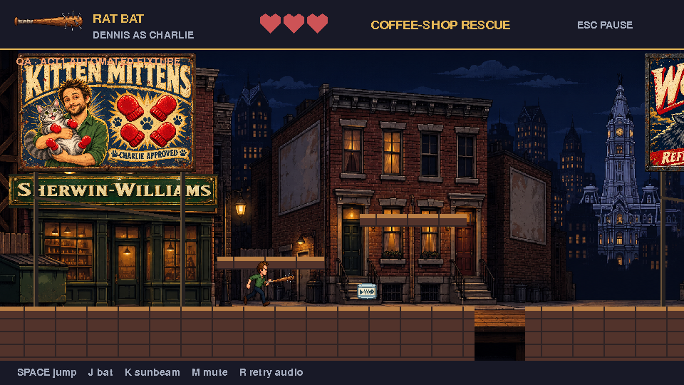
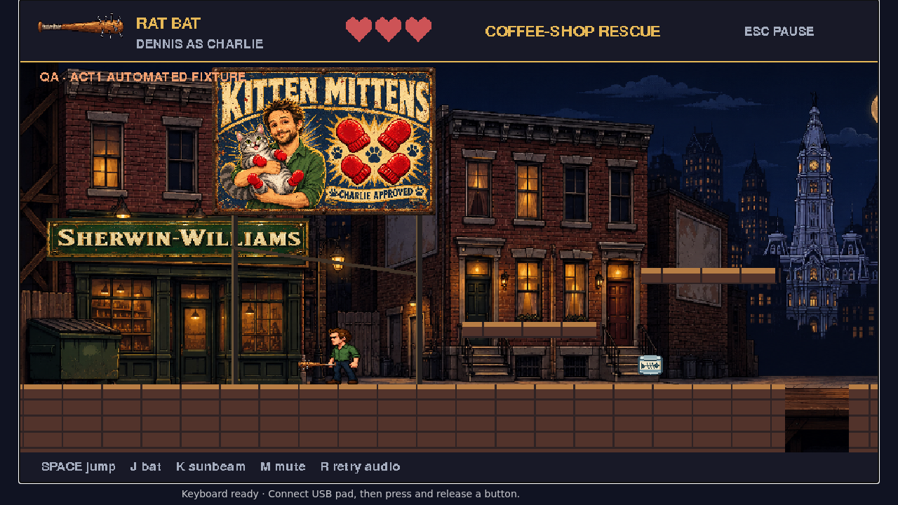
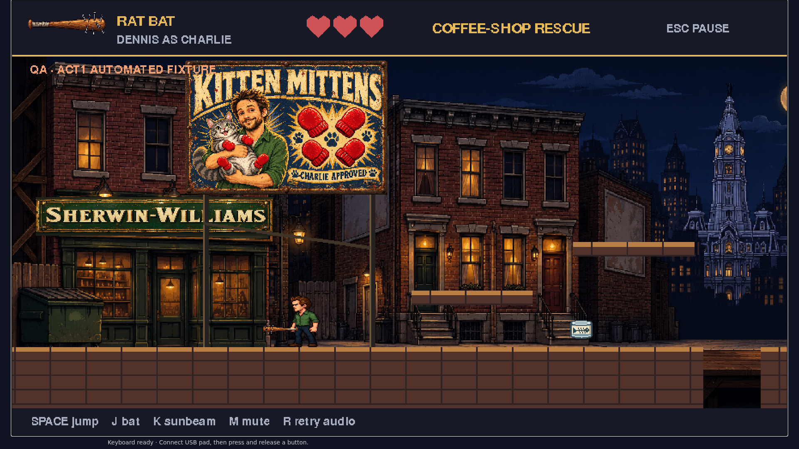
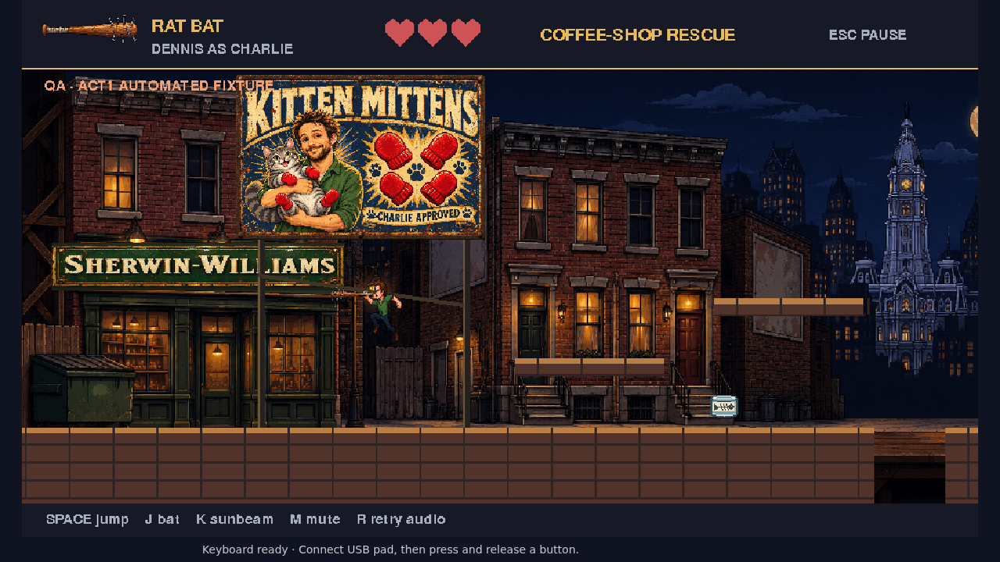

# Rat-bat grip evidence

Actual browser frames from ordinary keyboard motion within an isolated QA fixture. Main inspected all eight captures: handle remains attached, barrel pitches around grip in both directions; idle/jump remain attached; narrow desktop guidance retained. Four running frames are native 960x540 canvas captures at1280x720 viewport, remaining captures are full viewports. This is scoped animation proof, not a qualifying full walkthrough or the requested final audio video.

Synthetic handle regression:8 observed failures before fix;18 grip/world checks passed afterward. Focused Chromium passed. Initial400ms input capture missed one pose on Pi; corrected driver to bounded1000ms presses and all four poses captured. No game behavior changed for that driver correction.

