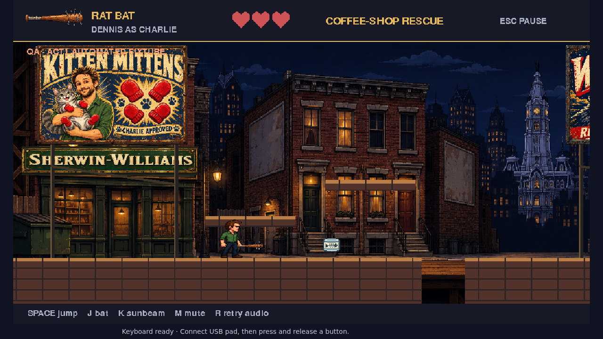
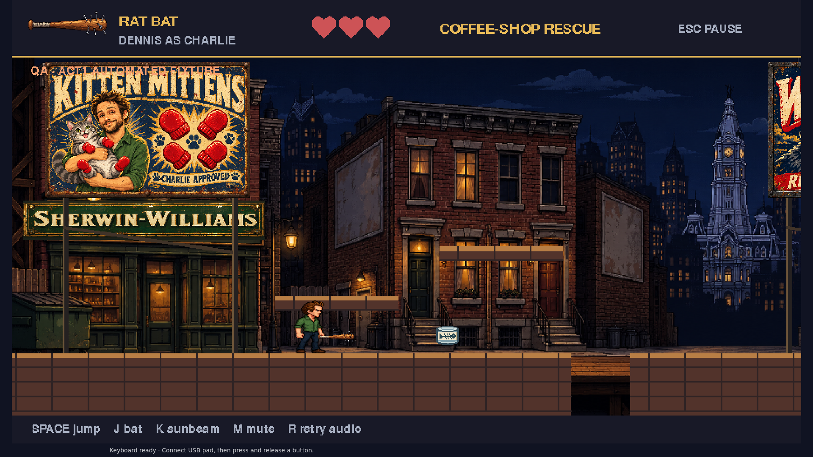
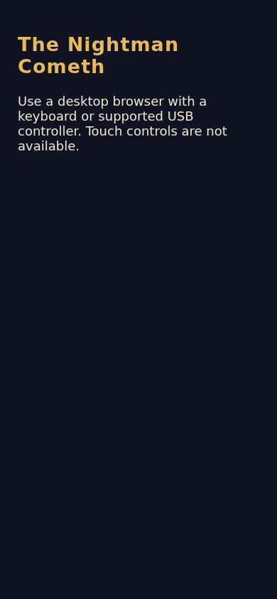
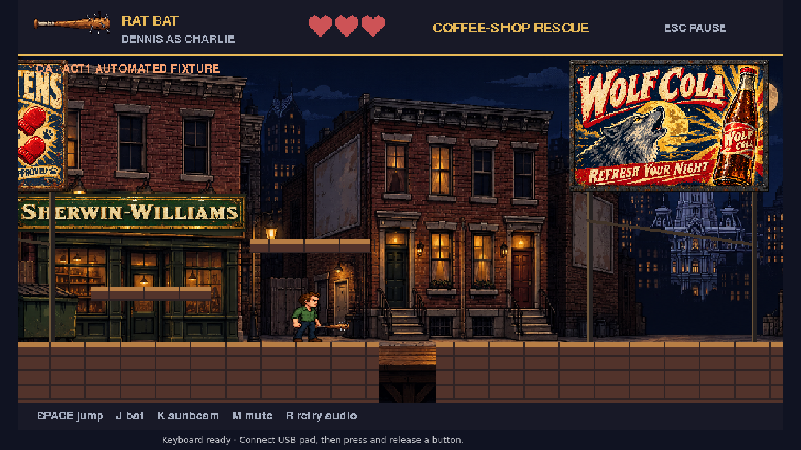

# Cat-food can evidence

Actual browser fixture captures, inspected by main. Can visible before collection and absent afterward with Dennis alive and three hearts. Narrow capture checks desktop-only messaging. Existing10 world regressions pass; focused Chromium1passed49.3s. The initial held-key driver overshot into a pit after its assertion; replaced with bounded100ms presses and live-state assertions before/after capture. Only corrected captures are published. No pickup mechanics changed.

