# Jump and stationary hurt-pose refinement

Actual browser evidence at ebeb420. Main visually inspected all33 images before publication. Four jump views show a raised bat anchored to the hand for normal/Dayman both facings. All3 bosses hold their upright hurt pose and blink; no rotation/fall. Their pause/focus freeze and transition at3seconds passed; running/attack recovery and live projectile checks also passed. No captured browser faults.207 unit tests passed;28 meaningful new failures preceded implementation.

1280x720 default viewport,1920x1080 Dayman-right jump,390x844 unsupported-mobile guidance. Running images are140x100 browser actor crops; boss images native960x540 canvases. See manifest and paired state/traces. This gallery supersedes prior motion-gallery jump/defeat appearance; old recoil/fall captures are historical. No physicalUSB or finalfull-route/audio-video acceptance claimed.

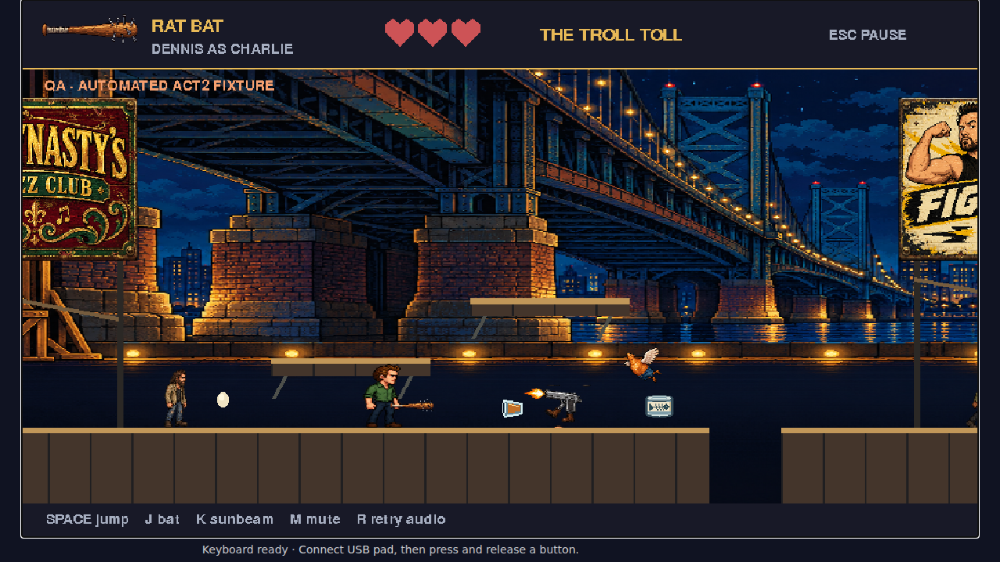

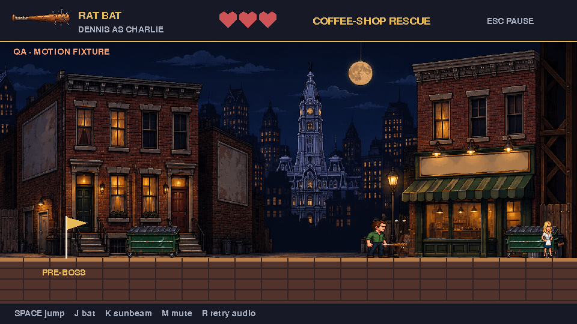

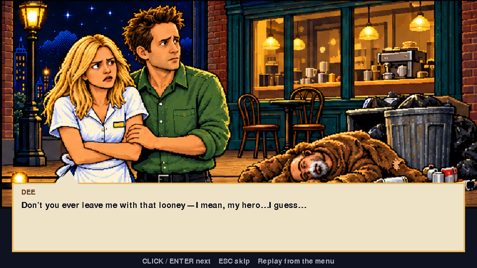

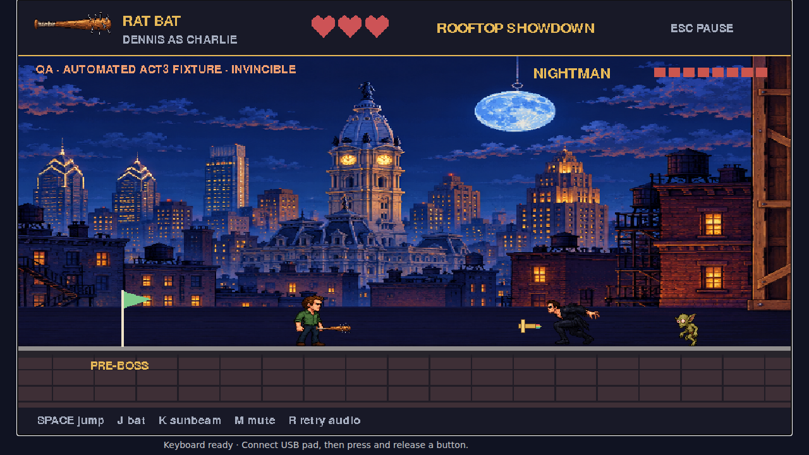

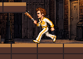

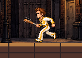

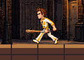

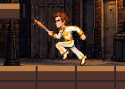

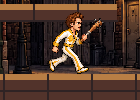

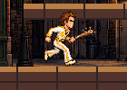

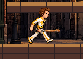

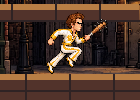

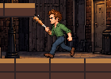

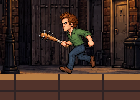

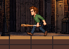

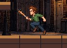

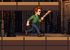

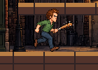

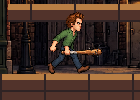

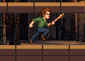

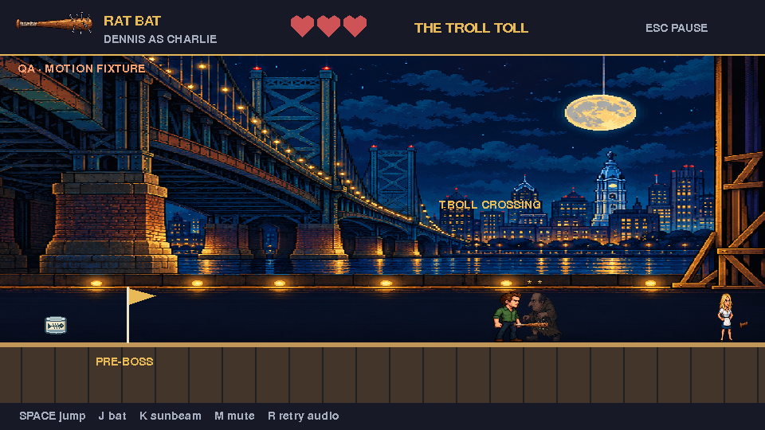

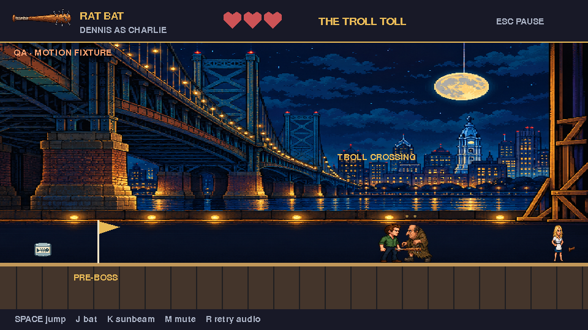

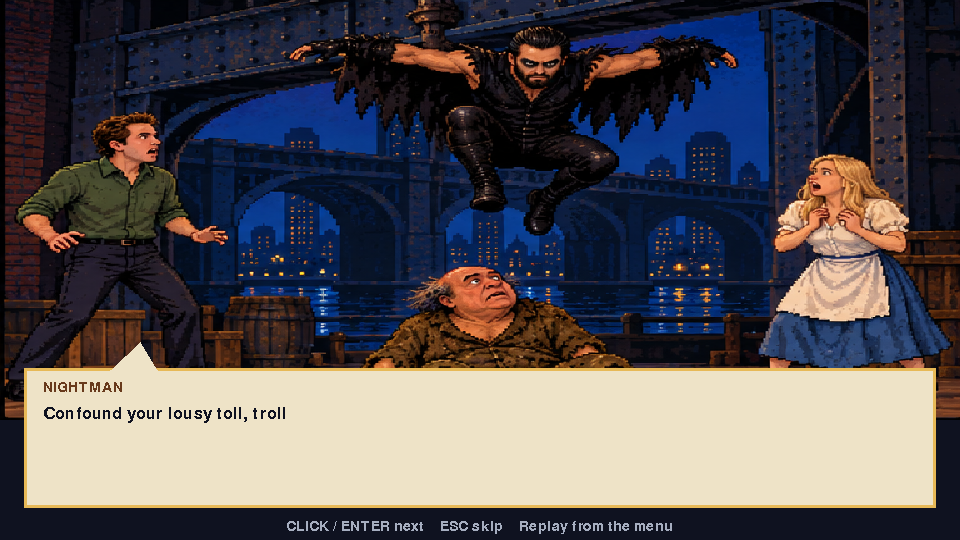

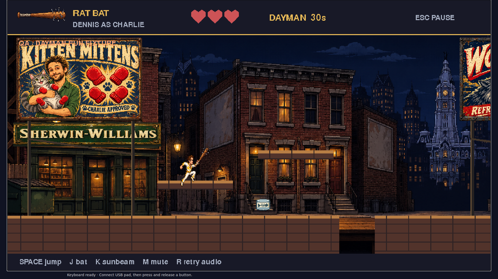

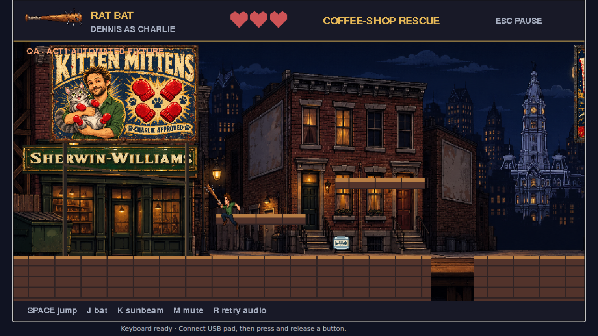

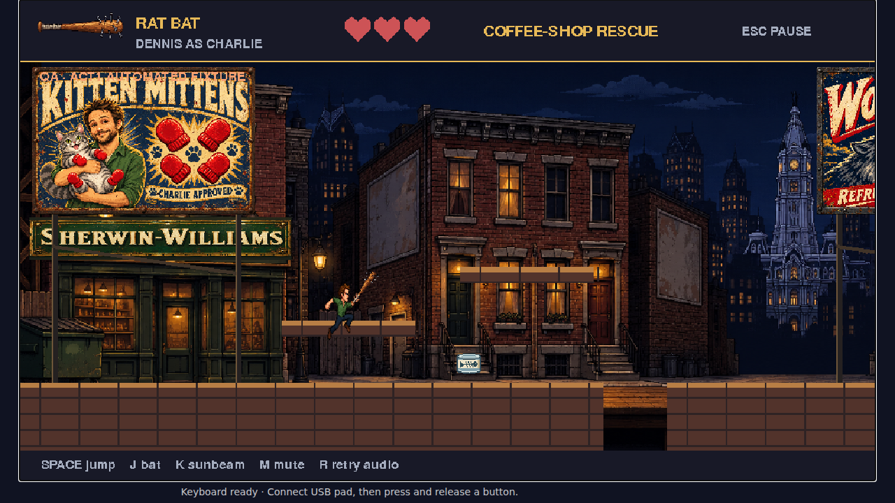

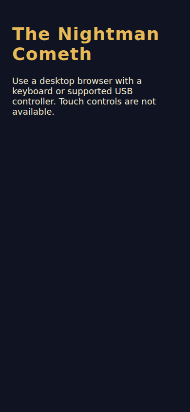

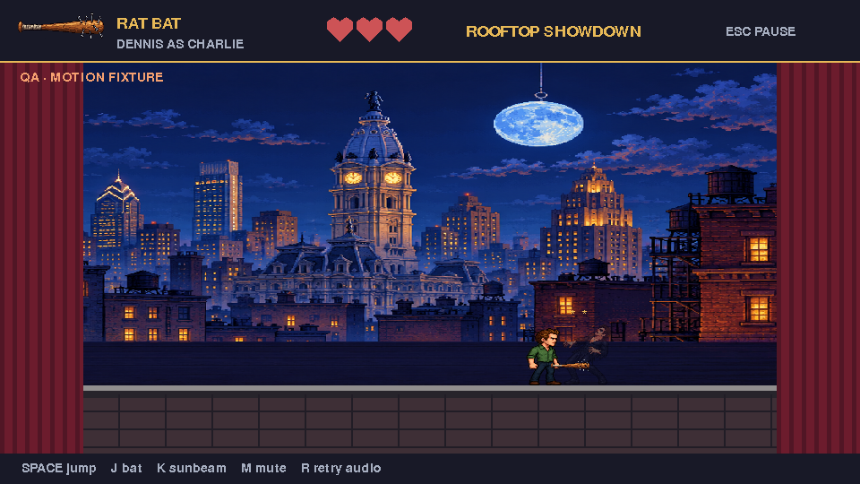

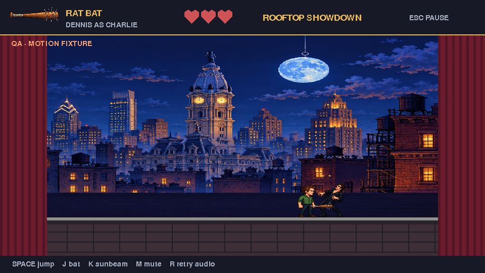

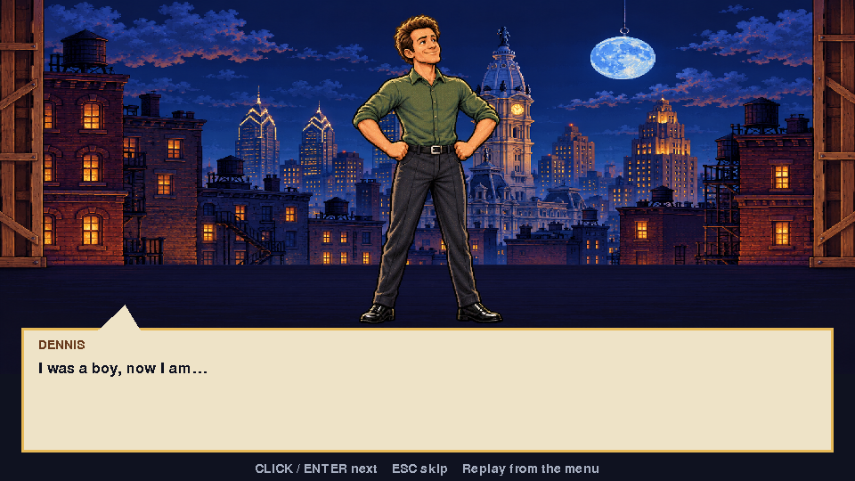

